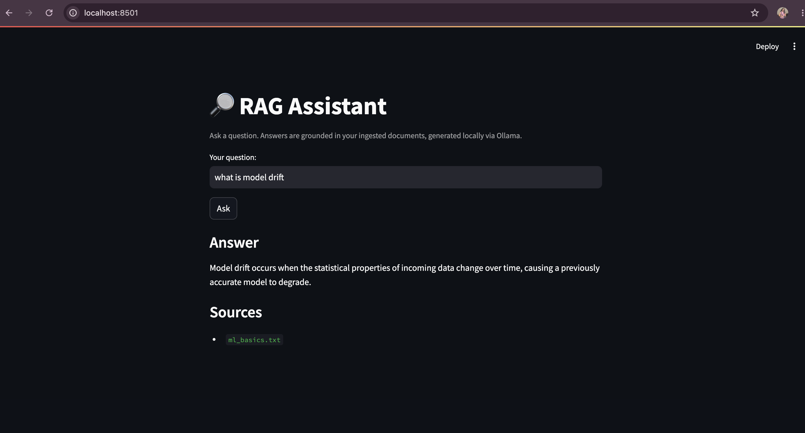

# 🔎 RAG Assistant

A local, fully-functional Retrieval-Augmented Generation (RAG) system: documents are chunked, embedded, and stored in a vector database, then retrieved and used to ground answers from a locally-running LLM — no paid API required.



## What it does

Ask a question in plain English. The system:
1. Embeds the question using `sentence-transformers`
2. Retrieves the most relevant chunks from a ChromaDB vector store
3. Passes those chunks as context to a local LLM (via Ollama)
4. Returns a grounded answer, along with the source document(s) it came from

This avoids hallucination by forcing the model to answer only from retrieved context, and keeps a transparent link between every answer and its source.

## Architecture

data/sample_docs/ → chunking → embeddings → ChromaDB (vector store)
↓
user question → embed → similarity search
↓
retrieved chunks + question → Ollama (local LLM)
↓
FastAPI (/query) → Streamlit UI


## Tech stack

- **Embeddings:** `sentence-transformers` (all-MiniLM-L6-v2, runs locally, no API cost)
- **Vector store:** ChromaDB (persistent, local)
- **LLM:** Ollama (llama3.2, runs fully locally — no API key needed)
- **Backend:** FastAPI
- **Frontend:** Streamlit
- **Testing:** pytest, with mocked LLM calls for fast, CI-safe tests
- **CI/CD:** GitHub Actions (runs test suite on every push)
- **Containerization:** Docker + docker-compose

## Running locally

**Prerequisites:** Python 3.11+, [Ollama](https://ollama.com) installed

```bash
# 1. Clone and set up environment
git clone https://github.com/ganapriyahs/rag-assistant.git
cd rag-assistant
python3 -m venv venv
source venv/bin/activate
pip install -r requirements.txt

# 2. Pull the local LLM
ollama pull llama3.2
ollama serve   # keep running in a separate terminal

# 3. Configure environment
cp .env.example .env

# 4. Ingest documents (add your own .txt files to data/sample_docs/ first)
python -m app.ingest

# 5. Run the API (separate terminal)
python -m uvicorn app.main:app --reload

# 6. Run the UI (separate terminal)
streamlit run ui/streamlit_app.py
```

Visit `http://localhost:8501` for the UI, or `http://localhost:8000/docs` for the interactive API docs.

## Running with Docker

```bash
docker compose up --build
```

Requires `ollama serve` running on the host machine — the container reaches it via `host.docker.internal`.

## Running tests

```bash
python -m pytest -v
```

Tests mock LLM calls so they run instantly and don't require Ollama — this is also what makes CI possible without a self-hosted runner.

## What this project demonstrates

- End-to-end RAG pipeline design (chunking strategy, embedding, retrieval, grounded generation)
- API design with FastAPI, including request/response validation via Pydantic
- Testing strategy for systems with external/local dependencies (mocking the LLM layer)
- Containerization and cross-container networking (bridging Docker to a host-level service)
- CI/CD setup with GitHub Actions
- Clean separation of concerns: ingestion, retrieval logic, API layer, and UI are fully decoupled

## Possible extensions

- Swap Ollama for a hosted LLM via environment variable (already scaffolded — the client just needs a different base URL)
- Add support for PDF/DOCX ingestion, not just `.txt`
- Add a re-ranking step after initial retrieval for better relevance
- Persist chat history in the Streamlit UI